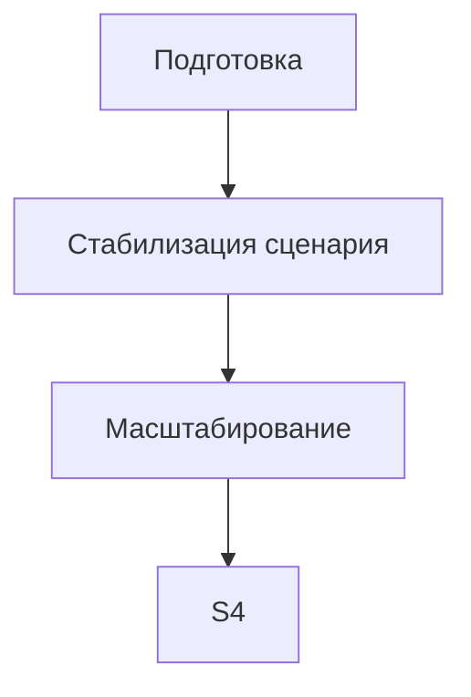

# Roadmap миграции RetailCore
## 0. Паспорт roadmap
| Поле                             | Значение                                                                                                                |
|:---------------------------------|:------------------------------------------------------------------------------------------------------------------------|
| Название проекта                 | Инкрементальная миграция RetailCore (первый релиз)                                                                      |
| Связанный документ трансформации | [transformation.md](../Task3/transformation.md)                                                                         |
| Горизонт планирования            | Первый релиз; квартал                                                                                                   |
| Выбранная стратегия миграции     | Поэтапная миграция, без остановки бизнеса                                                                               |
| Ключевые паттерны                | Strangler Fig (ядро сохраняется как write model); Event‑Driven; Anti‑Corruption Layer (ACL); Transactional Outbox + CDC |
| Автор                            | Иванов И.И., архитектор RetailCore                                                                                      |
| Дата                             | 11.11.2026                                                                                                              |
| Версия                           | v1.0                                                                                                                    |

## 1. Краткое резюме roadmap

Миграция выполняется инкрементально, потому что критичный order flow checkout имеет высший приоритет риска (`CNST‑02`).
Ядро Java-монолита и ORACLE OLTP сохраняются как авторитарный источник истины (_authoritative write model_) — это 
гарантирует отсутствие двойного источника данных и безопасность для конверсии.

Сначала команда фиксирует committed-записи атомарно вместе с state через _Transactional Outbox_, транслирует 
legacy‑данные из Oracle в канонические события через _Legacy Event Adapter_ и публикует их в _Event Backbone_. 
Это создаёт контрактную границу между старым и новым контуром без dual‑write.

На первом этапе вводятся Promo Microservice с fallback‑логикой, изолированный аналитический read-контур
_(Analytical Store_) и pilot‑партнёрский integration facade. Эти изменения не затрагивают critical path записи 
заказа и имеют минимальный риск деградации.

Только после shadow‑верификации полноты событий и согласованной модели статусов переключаются support-tools на Order 
Timeline Service. Такой порядок диктуется зависимостями:
* Legacy Event Adapter зависит от outbox relay
* Order Timeline зависит от event completeness
* Partner Adapter требует contract tests для одного пилотного партнёра

Основные риски связаны с полнотой событий, freshness проекции статусов и нагрузкой on‑prem брокера сообщений. 
Для каждого этапа заданы критерии готовности и условия остановки.

## 2. Стартовое и целевое состояние 
|         Состояние         | Описание                                                                                                                                                                                                                                                                                                                                                        | Ключевые ограничения                                                                                                                        | Метрики/признаки состояния                                                                                                                 |
|:-------------------------:|:----------------------------------------------------------------------------------------------------------------------------------------------------------------------------------------------------------------------------------------------------------------------------------------------------------------------------------------------------------------|:--------------------------------------------------------------------------------------------------------------------------------------------|:-------------------------------------------------------------------------------------------------------------------------------------------|
|           AS‑IS           | Монолитное ядро оформляет заказы по текущему critical path. Логика промо фрагментирована между кодом и пакетами Oracle; fallback неполон. Статусы реализованы в разных местах; поддержка работает как «ручной адаптер». Аналитические пайплайны нагружают оперативную базу direct SQL access. Интеграции разнородны; часть использует запись в общую таблицу БД | On‑prem capacity близка к пределу (CNST‑05, RISK‑11); нет количественных SLA/SLO; bus-factor промо-правил; расхождение статусов у поддержки | Нагрузка на OLTB; доля ручных обходов; время разбора обращений; latency checkout-процессов                                                 |
| Промежуточное состояние 1 | Введены Promo Microservice с fallback‑логикой; публикуются события OrderDiscounted. .NET Integration переведён на JMS‑очереди для one pilot-партнёра. Появился Analytical Store, наполняемый событиями; отчёты отключаются от direct SQL поэтапно                                                                                                               | Ядро checkout остаётся в монолите/Oracle; authoritative status write path не меняется                                                       | P95 отклика промо-сервиса < 200 мс; нагрузка на OLTB снижена ≥30%; BI сверка одного отчёта; дубли/DLQ partner adapter ≤ пороговых значений |
| Промежуточное состояние 2 | Shadow‑read модель статусов (Order Timeline) прошла quality gate по полноте и freshness. Согласована каноническая модель статусов; инвентаризированы writers legacy-значений                                                                                                                                                                                    | Checkout‑flow и payment остаются в монолите; полная унификация статусов отложена                                                            | Расхождения status history с Oracle < согласованного порога; обращения по статусам снизились на X%                                         |
|    TO-BE первого этапа    | Сохраняется Java‑монолит и ORACLE OLTB как source of truth заказов. Новые компоненты строят производные read‑модели или контрактные границы. Pilot checkout flow проходит shadow-тестирование; компенсационные сценарии протестированы                                                                                                                          | На этом горизонте не переносится operational data с Oracle; full отказ от legacy‑SQL отложен                                                | Freshness проекций статусов; coverage events; load test broker; retention policy analytical store                                          |

## 3. Принципы построения roadmap
1. **Сначала наблюдаемость, потом переключение:** Все новые read‑контуры проходят shadow‑режим с reconciliation расхождений перед переводом реального трафика.
2. **Сначала контрактная граница, потом расширение сценария:** Партнёрские интеграции переводятся по одному контракту через ACL; rules for degraded mode утверждаются до включения нового фасада.
3. **Сначала модель статусов, потом коммуникация:** Order Timeline строится на событиях до того, как support-tools переключается на новую модель.
4. **Сначала реестр потребителей данных, потом декомпозиция:** Inventory всех writers legacy‑записей завершается до выноса operational data с Oracle.

## 4. Roadmap миграции
| Этап                                   | Цель                                                       | Промежуточное состояние                                                                                                                 | Основные работы                                                                                                     | Зависимости                                                                                            | Риски                                                                                   | Критерии завершения                                                                                                |
|:---------------------------------------|:-----------------------------------------------------------|:----------------------------------------------------------------------------------------------------------------------------------------|:--------------------------------------------------------------------------------------------------------------------|:-------------------------------------------------------------------------------------------------------|:----------------------------------------------------------------------------------------|:-------------------------------------------------------------------------------------------------------------------|
| AS‑IS                                  | Зафиксировать стартовую точку                              | Монолитный Java‑ядро + ORACLE OLTP как source of truth заказов. Прямой SQL access аналитики; разнородные интеграции                     | Сбор baseline метрик нагрузки OLTB, latency checkout-процессов, доли ручных обходов поддержки                       | —	                                                                                                     | Отсутствие количественных NFR (`GAP‑01`, `GAP‑02`)                                      | Базовая линия подтверждена; пробелы данных зафиксированы.                                                          |
| 0. Подготовка и измерение              | Создать safe seams вокруг ядра                             | Введены Outbox Relay / CDC рядом с владельцем state; настроен on‑prem брокер сообщений                                                  | Развёртывание Kafka/Broker; настройка индексов/retention Oracle outbox; нагрузочный тест capacity broker            | On‑prem ресурсы близки к пределу (`CNST‑05`)                                                           | Нагрузка relay превышает capacity; lag выше порога                                      | Load test OK; retention policy согласована; RBAC observability pipeline утверждён после `Q‑09`                     |
| 1. Пилотный контур                     | Проверить событийный поток и pilot‑интеграцию              | Promo Microservice публикует события OrderDiscounted; .NET‑integration переведён на JMS‑очереди; Analytical Store наполняется событиями | Запуск Promo Microservice с fallback‑логикой; shadow‑переключение одного отчёта аналитики; пилотный partner adapter | Inventory writers legacy‑записей не завершён (`GAP‑01`); contract tests partner integration (`GAP‑08`) | Unmapped events > порогового значения; дубли заявок у партнёра; расхождения BI‑отчётов  | P95 отклика промо < 200 мс; доля корректных скидок больше или равно 99%; load test broker OK; BI сверка one report |
| 2. Стабилизация сценария               | Shadow‑read модель статусов и инвентаризация legacy‑правил | Order Timeline Service проходит quality gate полноты; support-tools переключаются поэтапно                                              | Согласование канонической модели статусов; mapping coverage legacy‑значений; reconciliation quarantine              | Freshness проекций status history не гарантирована (`GAP‑04`)                                          | Расхождения с Oracle превышают согласованный порог; freshness нарушена                  | Доля расхождений меньше или равно 1%; обращения по статусам снизились на X%                                        |
| 3. Масштабирование/Pilot Checkout Flow | Подготовка к отказу от Oracle                              | Abstraction layer data-access поверх Oracle; new хранилища на целевой СУБД; start archive historical TBs                                | Инвентаризация всех writers legacy‑данных; выбор PostgreSQL/Target DB после `Q‑07`                                  | Полная миграция operational data отложена до согласования lifecycle write‑path                         | Data loss при backfill‑загрузке; нарушение инвариантов order flow                       | Writer inventory завершен; retention policy analytical store утверждена                                            |
| TO-BE первого этапа                    | Проверить достижение целевого состояния                    | Ядро RetailCore сохраняет authoritative write model; новые компоненты работают параллельно с legacy‑контуром                            | Capacity test impact read‑моделей; compensation paths протестированы                                                | На этом горизонте не переносится pricing/routing/payment core                                          | Остаточные риски связаны с bus-factor legacy-правил скидок; full замена Oracle отложена | Целевые метрики freshness, completeness, latency достигнуты                                                        |

## 5. Детализация этапов
## Этап 0: Подготовка и измерение (safe seams around the core)
|               Раздел                | Содержание                                                                                                                                                   |
|:-----------------------------------:|:-------------------------------------------------------------------------------------------------------------------------------------------------------------|
|             Цель этапа              | Создать контрактные границы вокруг ядра RetailCore; подготовить on‑prem брокер сообщений                                                                     |
| Какие точки трансформации закрывает | TR‑06 (Outbox Relay/CDC); подготовка Event Backbone                                                                                                          |
|       Что меняется в процессе       | Введены transactional boundaries для фиксации committed-записей атомарно вместе с владельцем state. Мониторинг событий не влияет на checkout-процесс         |
|     Что меняется в архитектуре      | Появляются Outbox Relay + CDC рядом с владельцами записи (_create order, status change, delivery slot_). Настроен Kafka/Broker как логический Event Backbone |
|           Что не меняется           | Ядро Java-монолита и ORACLE OLTP остаются authoritative source of truth заказов. Синхронный вызов Payment Gateway остаётся критичным path checkout           |
|           Входные условия           | On‑prem capacity близка к пределу (`CNST‑05`); пробелы данных GAP‑01–GAP‑08 зафиксированы                                                                    |
|          Выходные условия           | Load test broker OK; retention policy outbox утверждена; RBAC observability pipeline утверждён после закрытия GAP‑09                                         |
|            Метрики этапа            | Lag relay < согласованного SLA; индексы/retention настроены; дубли events меньше или равны порогового значения                                               |
|             Риски этапа             | Нагрузка relay превышает capacity; data loss при backpressure; персональные данные попадают в события без masking                                            |

## Этап 1: Пилотный контур
|               Раздел                | Содержание                                                                                                                                                                                                                                                                                                 |
|:-----------------------------------:|:-----------------------------------------------------------------------------------------------------------------------------------------------------------------------------------------------------------------------------------------------------------------------------------------------------------|
|             Цель этапа              | Проверить событийный поток OrderDiscounted; снизить нагрузку аналитики; изолировать one pilot-партнёра через ACL                                                                                                                                                                                           |
| Какие точки трансформации закрывает | TR‑01 Promo Microservice => Events => Analytical Store; TR‑02 Partner Adapter                                                                                                                                                                                                                              |
|       Что меняется в процессе       | Пользователи видят корректную цену; поддержка получает event‑driven историю скидок. BI-отчёты переключаются на new read-контур поэтапно. Один партнёр работает через Integration Facade вместо legacy‑пути                                                                                                 |
|     Что меняется в архитектуре      | Запущен Promo Microservice с fallback‑логикой; публикуются канонические события OrderDiscounted. Legacy Event Adapter транслирует legacy‑записи в backbone. Для пилотного партнёра введён Partner Adapter с idempotency key                                                                                |
|           Что не меняется           | Checkout‑flow и payment orchestration остаются в монолите/Oracle. Авторитарное состояние заказа сохраняется                                                                                                                                                                                                |
|           Входные условия           | Inventory writers legacy‑записей частично завершён (`GAP‑01`); contract tests partner integration (`GAP‑08`)                                                                                                                                                                                               |
|          Выходные условия           | Время отклика промо-сервиса p95 < 200 мс; доля заказов с корректными скидками > 99%; количество ручных обходов статуса скидки снижается. Нагрузка на Oracle снижена ≥30% по мониторингу БД; BI сверка одного отчёта подтверждает совпадение показателей. Retry/DLQ partner adapter ниже пороговых значений |
|            Метрики этапа            | Полнота событий больше или равно 99%; доля unmapped значений в quarantine; задержка публикации событий (lag); дубли заявок; расхождения callback                                                                                                                                                           |
|             Риски этапа             | Fallback‑логика неполна; дубли заявок у партнёра; потеря корреляции ID между событиями                                                                                                                                                                                                                     |

## Этап 2: Стабилизация сценария
|               Раздел                | Содержание                                                                                                                                                 |
|:-----------------------------------:|:-----------------------------------------------------------------------------------------------------------------------------------------------------------|
|             Цель этапа              | Shadow‑read модель статусов на событиях; снижение обращений поддержки                                                                                      |
| Какие точки трансформации закрывает | TR‑03 Order Timeline Service; инвентаризация legacy‑правил скидок                                                                                          |
|       Что меняется в процессе       | Поддержка видит единую прослеживаемую историю заказов; обращения по статусам снижаются. Расхождения видны в reconciliation dashboard                       |
|     Что меняется в архитектуре      | Build Order Timeline Service на канонических событиях; client‑side и internal проекции статуса. Support Tools работают в shadow‑режиме                     |
|           Что не меняется           | Authoritative lifecycle write path остаётся в монолите/Oracle. Полная унификация статусов отложена до Этапа 3                                              |
|           Входные условия           | Согласована каноническая модель статусов (`GAP‑04`); mapping coverage legacy‑значений завершен                                                             |
|          Выходные условия           | Расхождения status history с Oracle < согласованного порога; freshness проекции меньше или равно согласованного SLO; обращения по статусам снизились на X% |
|            Метрики этапа            | Доля расхождений status history; доля unmapped значений в quarantine; freshness проекции; MTTD/MTTR обращений; audit log recovery gateway                  |
|             Риски этапа             | Неполные события создают ложную уверенность; stale read может быть показан клиенту                                                                         |

## Этап 3: Масштабирование
|               Раздел                | Содержание                                                                                                                                  |
|:-----------------------------------:|:--------------------------------------------------------------------------------------------------------------------------------------------|
|             Цель этапа              | Подготовить abstraction layer data-access поверх Oracle; начато архивирование исторических данных                                           |
| Какие точки трансформации закрывает | TR‑07 Abstraction Layer; инвентаризация всех writers operational data                                                                       |
|       Что меняется в процессе       | Data owners фиксируют lineage показателей; backfill‑загрузка исторических данных в analytical store. Start архивирования «холодной» истории |
|     Что меняется в архитектуре      | Выбор целевой СУБД для new хранилищ после закрытия GAP‑07; versioned mapping legacy‑values                                                  |
|           Что не меняется           | В ядре остаются критичные write‑пути до согласования деградации                                                                             |
|           Входные условия           | Writer inventory legacy‑writers завершен; retention policy согласована                                                                      |
|          Выходные условия           | Capacity test impact read‑моделей OK; full backfill‑загрузка выполнена; retention policy analytical store утверждена                        |
|            Метрики этапа            | Lineage coverage показателей; retention compliance; доля потерянных записей при миграции                                                    |
|             Риски этапа             | Data loss при backfill‑загрузке; нарушение инвариантов order flow; несогласованные definitions метрик                                       |

## 6. Зависимости между этапами

### 6.1 Таблица зависимостей
| Зависимость                                                                    | 	Почему порядок жёсткий                                                                                                         | Что будет, если нарушить порядок                                                              | Как контролируем                                                                                      |
|:-------------------------------------------------------------------------------|:--------------------------------------------------------------------------------------------------------------------------------|:----------------------------------------------------------------------------------------------|:------------------------------------------------------------------------------------------------------|
| Этап "Подготовка" => Этап "Пилотный контур"                                    | Load test брокера сообщений необходим перед пилотным переключением; retention policy outbox утверждена после закрытия GAP‑09    | Lag relay превысит SLA; потеря зафиксированных изменений при backpressure                     | Capacity test broker OK; индексы/retention настроены.                                                 |                                                                                                       |                  |
| Этап "Пилотный контур" => Этап "Стабилизация сценариев статусов"               | Shadow‑read модель статусов невозможна до прохождения quality gate полноты событий Order Timeline Service (TR‑03, GAP‑04)       | Support tools увидят stale read вместо единой истории заказов; обращения по статусам вырастут | Доля расхождений меньше или равно согласованного порога; freshness проекции меньше или равно T+1 час. |                                                                                                                                  |                  |
| Этап "Стабилизация сценариев статусов" => Этап "Масштабирование checkout‑flow" | Выбор целевой СУБД для new хранилищ зависит от инвентаризации writers legacy‑данных и согласования lifecycle write‑path (TR‑07) | Data loss при backfill‑загрузке исторических TBs; нарушение инвариантов order flow            | Writer inventory завершён; retention policy аналитической витрины утверждена.                         |                                                                                                       |                  |

## 7. Управление рисками roadmap 
|              Этап               |                                  Риск                                  |    Вероятность    |                                Влияние                                | Контроль                                                                       | Условие остановки                                                                                      | Владелец                       |
|:-------------------------------:|:----------------------------------------------------------------------:|:-----------------:|:---------------------------------------------------------------------:|:-------------------------------------------------------------------------------|:-------------------------------------------------------------------------------------------------------|:-------------------------------|
| AS‑IS => Подготовка и измерение |                  Нагрузка on‑prem превышает capacity                   | Зависит от GAP‑06 |                     Деградация checkout-процессов                     | Capacity test broker; backpressure, rate limits                                | Ограничение write‑rate new‑контуров до увеличения ресурсов                                             | Инфраструктура                 |
|     Пилотный контур событий     |          Event stream неполон; unmapped значения в quarantine          |      Средняя      |          Неверная история заказов; расхождения read-моделей           | Writer inventory legacy‑записей; shadow‑read coverage matrix                   | Переключение support-tools откладывается до прохождения quality gate полноты событий (GAP‑04)          | Техлид ядра + DBA              | 
|     Пилотный контур событий     |                Новый контур становится source of truth                 |      Высокая      |  Два владельца состояния заказа => нарушение инвариантов order flow   | Явно сохранить Oracle authoritative; запрет прямых команд через event backbone | Rollback проекции статусов до legacy‑read path                                                         | Архитектор RetailCore          |
|     Пилотный контур событий     |                   Retry / DLQ партнёрской интеграции                   |      Средняя      |             Нарушение обещания доставки; повторная оплата             | Idemponent consumers; exclusive routing flag; reconciliation дубли             | Остановка pilot-партнёра до устранения root cause дублей заявок                                        | Эксплуатация брокера сообщений |
| Стабилизация сценариев статусов |                  Схемы событий меняются несовместимо                   |      Низкая       |                    Поломка нескольких потребителей                    | Schema versioning, compatibility checks, consumer contract tests               | Rollback schema до восстановления consumers                                                            | Tech Lead Kernel               |
| Стабилизация сценариев статусов |               Расхождения status history превышают порог               |      Средняя      |  Поддержка продолжает работать как "ручной адаптер"; рост обращений   | Shadow‑read freshness ≤ T+1 час; расхождения < согласованного порога           | Откат shadow‑режима до согласования mapping coverage                                                   | Ответственный за поддержку     | 
|  Масштабирование checkout‑flow  |          Data loss при backfill‑загрузке исторических данных           |      Средняя      |  Нарушение целостности order flow; расхождения аналитических витрин   | Проверка lineage и retention policy после GAP‑06; dry‑run backfill             | Остановка full миграции operational data до устранения потери данных                                   | Инфраструктура + DBA           |
|  Масштабирование checkout‑flow  | Нарушение инвариантов order flow из‑за неполной инвентаризации writers |      Высокая      | Rollback compensation paths невозможен; деградация checkout-процессов | Writer inventory завершен; contract tests compensation scenarios               | Откат feature flag pilot‑checkout shadow-тестирования до согласования fallback-стратегии (вопрос Q‑04) | Архитектор RetailCore          |

## 8. Метрики и контрольные точки
| Контрольная точка                  | Когда проверяем                               | Что проверяем                                                | Целевой порог                                               | Источник данных                   | Решение по результату                                                                                       |
|:-----------------------------------|:----------------------------------------------|:-------------------------------------------------------------|:------------------------------------------------------------|:----------------------------------|:------------------------------------------------------------------------------------------------------------|
| Подготовка брокера сообщений       | До развёртывания Outbox Relay / CDC           | Capacity broker; retention policy outbox                     | Lag relay < согласованного SLA; индексы/retention настроены | Monitoring Kafka/RabbitMQ         | Ограничение write‑rate до оптимизации capacity; откат RBAC observability pipeline без закрытия вопроса Q‑09 |
| Shadow‑переключение Order Timeline | Во время пилотного переключения support-tools | Доля расхождений status history с Oracle; freshness проекции | меньше или равно согласованного порога; T+1 час             | Grafana => Order Timeline Service | Откат feature flag до прохождения quality gate полноты событий (GAP‑04)                                     |
| Сверка одного отчёта BI            | Перед отключением legacy SQL access аналитики | Совпадение показателей BI и legacy‑SQL                       | Расхождения меньше или равно согласованного порога          | Сводная таблица владельца данных  | Отчёт не отключается с legacy‑SQL до подтверждения lineage                                                  | 
| Нагрузочный тест checkout flow     | После инвентаризации writers legacy‑данных    | Задержка подтверждённой покупки; потеря начислений           | P95 latency ниже порога; no data loss                       | Мониторинг БД, New Relic          | Остановка pilot‑checkout flow до устранения root cause задержки                                             | 
| Acceptance пилотного партнёра      | При включении Partner Adapter                 | Частота retry/DLQ; дубли заявок                              | Ниже пороговых значений                                     | Monitoring очереди JMS/Kafka      | Остановка pilot-партнёра до устранения дублей.                                                              | 
| Audit Recovery Gateway             | Перед включением разрешённых команд           | Four‑eyes rules; reason code; аудит recovery gateway         | Audit зафиксирован; dry‑run завершён                        | Support Dashboard                 | Утвердить каталог команд до включения Recovery Gateway                                                      |

## 9. Промежуточные состояния
| Промежуточное состояние               | Что уже работает                                                                                                                                                                             | Что ещё остаётся в легаси                                                                         | Как пользователь видит сценарий                                                        | Как поддержка видит сценарий                                                                                | Основные риски                                                                                                              |
|:--------------------------------------|:---------------------------------------------------------------------------------------------------------------------------------------------------------------------------------------------|:--------------------------------------------------------------------------------------------------|:---------------------------------------------------------------------------------------|:------------------------------------------------------------------------------------------------------------|:----------------------------------------------------------------------------------------------------------------------------|
| AS‑IS (Стартовая точка)               | Монолитный Java-монолит + ORACLE OLTP как authoritative write model заказов. Прямой SQL access аналитики; разнородные интеграции                                                             | —                                                                                                 | Оформляет заказ через маркетплейс или сайт; видит цену и статус в личном кабинете      | Воссоздаёт историю заказа вручную; расхождения цифр у маркетинга/финансов/операций                          | Нагрузка on‑prem близка к пределу (CNST‑05, RISK‑11); bus-factor промо-правил; отсутствие единого источника правды (APP‑08) |                                                                                                                     
| Этап 0: Подготовка и измерение        | Фиксация committed-записей атомарно вместе с владельцем state (create order, status change) => Kafka/Broker. Legacy Event Adapter транслирует legacy‑записи в канонические события           | Ядро checkout‑flow, payment orchestration остаются в монолите                                     | Пользователь не замечает изменений; расчёт скидок происходит как раньше                | Получает события OrderDiscounted для shadow‑проверки полноты; мониторинг событий не влияет на critical path | Lag relay брокера превышает capacity; потеря зафиксированных изменений при backpressure                                     |                           
| Этап 1: Пилотный контур событий       | Promo Microservice публикует скидки; fallback‑логика в монолите. .NET Integration переведён на JMS-очереди; pilot-партнёр использует Partner Adapter. Analytical Store наполняется событиями | Payment Gateway критичен для checkout; routing логистики остаётся в монолите                      | Видит корректную цену; BI-отчёты переключаются поэтапно после сверки показателей       | Работает с event‑driven историей скидок от promo-сервиса; один пилотный партнёр использует новый контракт   | Unmapped значения в quarantine > порогового значения; дубли заявок pilot-партнёра                                           | 
| Этап 2: Shadow‑read статусов          | Order Timeline Service проходит quality gate полноты; client‑side проекция статуса                                                                                                           | Авторитетное write‑path status lifecycle остаётся в монолите/Oracle                               | Статусы отображаются клиентской проекцией; уведомления приходят вовремя                | Работает в shadow‑режиме; расхождения видны в reconciliation dashboard; обращения по статусам снижены       | Расхождения с Oracle превышают согласованный порог; freshness нарушена                                                      |                                                                                                                                            
| Этап 3: Масштабирование checkout-flow | Слой абстракции доступа к данным поверх Oracle; выбор целевой СУБД после GAP‑07; архив исторических TBs                                                                                      | Core checkout‑flow, pricing/routing/payment remain in monolith до согласования compensation paths | Checkout-процесс проходит shadow-тестирование; компенсационные сценарии протестированы | Имеет доступ к lineage показателей; audit recovery gateway фиксирует разрешённые команды                    | Data loss при backfill‑загрузке; нарушение инвариантов order flow из-за неполной инвентаризации writers                     |                                                      

## 10. Связь roadmap с cutover-планами
| Ключевой переход                            | На каком этапе | Почему нужен отдельный cutover‑plan                                                                                                                                                                                                          |        Связанный файл        |
|:--------------------------------------------|:---------------|:---------------------------------------------------------------------------------------------------------------------------------------------------------------------------------------------------------------------------------------------|:----------------------------:|
| TR‑03 Order Timeline/Status Query API       | Этап 2         | Решает проблему наблюдаемости статусов (APP‑04, RISK‑03) без изменения authoritative write path checkout‑flow. Требует shadow‑переключения read‑модели и quality gate полноты событий                                                        |       cutover-plan.md        |
| TR‑05 Partner Adapter/Integration Facade    | Этапы 1,2      | Зависит от contract tests pilot-партнёра; его acceptance включён в контрольную точку мониторинга дубли заявок (P‑04). Переключение критичного партнёра требует отдельного плана переключения                                                 |      partner-cutover.md      |
| TR‑04 Analytical Store => BI отчёты         | Этап 1         | Снижение нагрузки на OLTP Oracle за счёт событийного потока. Переключение одного пилотного отчёта требует сверки показателей до отключения legacy SQL access                                                                                 |     analytics-cutover.md     |
| TR‑07 Abstraction Layer/Pilot Checkout Flow | Этап 3         | Подготовка к отказу от Oracle; start archive historical TBs. Shadow-тестирование compensation paths и lifecycle write‑path. Это первый шаг к переносу operational data — требуется отдельный план для проверки деградации checkout-процессов | checkout-flow-shadow-test.md |

## 11. Открытые вопросы
| Вопрос                                                           | Почему важно уточнить                                                                  | Кто должен ответить                  | Срок                                     | Что делаем, если ответа нет                                                            |
|:-----------------------------------------------------------------|:---------------------------------------------------------------------------------------|:-------------------------------------|:-----------------------------------------|:---------------------------------------------------------------------------------------|
| GAP‑01: Правила деградации промо-сервиса                         | Без них fallback будет неполным; невозможно настроить алерты на недоступность сервиса  | Бизнес-владелец скидок + техлид ядра | До разработки Promo Microservice         | Нельзя настраивать fallback-логику в монолите; нельзя включать quality gate деградации |
| GAP‑04: Допустимая задержка репликации событий                   | Определяет freshness проекции Order Timeline; без неё нельзя переключать support-tools | Владельцы статусов и аналитики       | До shadow‑переключения read‑модели       | Переключение откладывается до прохождения quality gate полноты событий                 |
| GAP‑06: Архивирование исторических данных                        | Ограничивает объём событий; backfill‑загрузка невозможна без retention policy          | Инфраструктура + аналитика           | До наполнения analytical store событиями | Нельзя отключать direct SQL access analytics до завершения загрузки истории            |
| Q‑09: Security, Персональные данные, RBAC observability pipeline | Блокирует публикацию событий и telemetry                                               | ИБ/Compliance                        | До включения observability pipeline      | Остановить deploy до согласования masking sensitive data                               |

