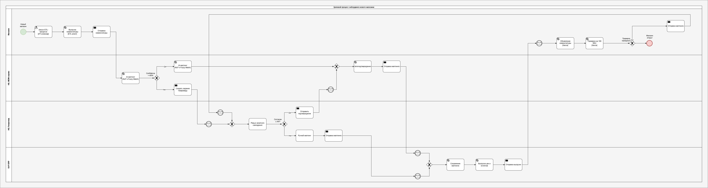

# Целевой процесс онбординга нового магазина
Разработана целевая схема (TO-BE) процесса интеграции новых магазинов в контур VitaStore. Логика процесса формализована 
в нотации BPMN 2.0 и предполагает замену ручного сопоставления номенклатуры на автоматизированный ИИ-конвейер

## Описание точки верификации (Товаровед) — Реализация паттерна Human-in-the-Loop
<b>Где находится:</b> Дорожка «HQ. Товаровед», задача «Ревью нечеткого совпадения»

<b>Суть:</b> Это ключевой элемент архитектуры Human-in-the-Loop (HITL) — точка, где автоматизированный конвейер передает
управление человеку для принятия решений в спорных ситуациях. Человек здесь выступает не как оператор ввода, 
а как контролер качества (QA).

<b>Триггер:</b> Товаровед получает задачу только тогда, когда ИИ-сервис в дорожке «HQ. MDM-сервис» оценил уровень 
уверенности (Confidence) сопоставления ниже 95% (Проверка по условию «Confidence >= 95%?» по ветке «Нет»).

<b>Интерфейс:</b> В отличие от AS-IS (где был Excel), здесь товаровед работает в специализированном интерфейсе 
MDM-системы. Он видит карточку: 
<i>«Название из старой сети: [Значение] — Предложение ИИ: [Название, ID] — Уверенность: 85%»</i>.

<b>Действие:</b>
* <b><i>«Да» (Согласен с ИИ):</i></b> Товаровед нажимает кнопку подтверждения. Данные автоматически уходят дальше в SAP.
* <b><i>«Нет» (Не согласен):</i></b> Товаровед выполняет «Ручной маппинг», принудительно связывая позицию с правильным 
эталоном из базы VitaStore.

<b>Результат:</b> Благодаря реализации Human-in-the-Loop, процесс не ждет, пока человек обработает всё вручную.
Товаровед вмешивается только в 5–10% случаев, что сокращает время его работы с 3 недель до нескольких часов.

## Описание потоков данных (Data Flow)
Процесс построен на передаче структурированных данных (JSON) между сервисами, исключая ручные выгрузки.

1. <b>Магазин => HQ (MDM-сервис):</b> 
ETL-агент забирает сырые данные из кассы и отправляет их по API в MDM-сервис. 
Формат: JSON с полями old_name, old_barcode, price.
2. <b>HQ (MDM-сервис) => ИИ:</b> 
Сервис вызывает модель NLP/Fuzzy Match. 
Трансформация: К каждой строке добавляется поле confidence_score (0.0–1.0) и suggested_vita_id.
3. <b>Разделение потока:</b> 
   * <b><i>Поток 1 (Автоверификация):</i></b> Если confidence >= 0.95, данные помечаются как status: auto_verified 
   и уходят в SAP.
   * <b><i>Поток 2 (Верификация / Human-in-the-Loop):</i></b> Если confidence < 0.95, создается задача в очереди 
   товароведа.
4. <b>HQ (Товаровед) => HQ (MDM-сервис):</b> 
После ручного или автоматического подтверждения данные получают статус status: human_verified и объединяются 
в единый массив.
5. <b>HQ (MDM-сервис) => SAP:</b> 
Финальный массив (10 000 позиций) публикуется в SAP. SAP здесь — пассивный получатель (System of Record).
6. <b>SAP => Магазин:</b> 
SAP выгружает готовые цены и остатки, которые касса получает для обновления.

## Способы снижения уровня ошибок

Заложено три уровня защиты, которые устраняют проблему 15% ошибок из AS-IS:
1. <b>Технический уровень (ETL-агент):</b> 
Исключение Excel и почты. Агент сам формирует JSON, проверяет валидность штрихкодов и цен. Битые данные отсекаются 
на входе.
2. <b>Алгоритмический уровень (ИИ + Бизнес-правила):</b> 
   * <b><i>ИИ-мэппинг:</i></b> Снижает вероятность опечатки при сопоставлении «Шамп.» и «Шампунь».
   * <b><i>Hard Rules (Жесткие правила):</i></b> В MDM-сервисе настроены ограничения. Система не пропустит маппинг, 
   если цена изменилась более чем на X% или если единица измерения (шт/кг) не совпадает.
3. <b>Процедурный уровень (Петля возврата и обучение HITL):</b> 
<b><i>Пилотная проверка (100 SKU):</i></b> Это «гейт-кипер». Если при тестовом сканировании выявлена ошибка, ветка «Нет» от условия
«Проверка пройдена?» ведет назад к задаче «Ревью нечеткого совпадения». Это не просто откат, а сигнал для ИИ: данный 
кейс («Было» vs «Стало») отправляется в датасет для дообучения модели. Таким образом, Human-in-the-Loop не только 
исправляет текущую ошибку, но и постоянно повышает точность автоматики для будущих магазинов.

